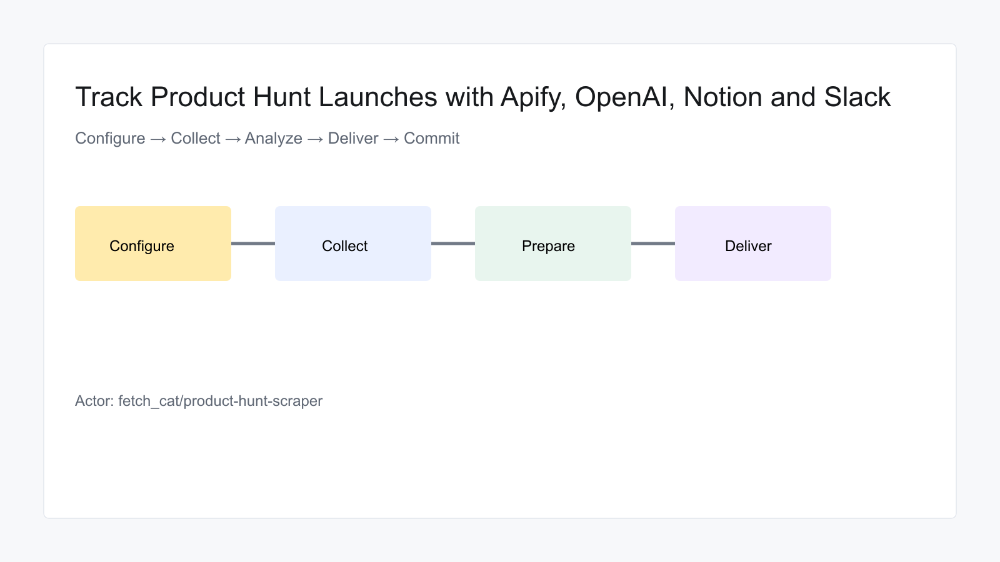

# Track Product Hunt Launches with Apify, OpenAI, Notion and Slack

Automate a practical monitoring and research workflow with `fetch_cat/product-hunt-scraper`. The template is compatible with n8n Cloud and self-hosted n8n, uses only built-in nodes, caps default collection at 10 items, and prevents duplicate delivery with transaction-safe state.

## Requirements

- Apify account and API token
- OpenAI credential for one batched `gpt-5.4-mini` request per non-empty run
- Notion database
- Slack destination

## Customization

Edit search values, threshold, result limit, and schedule in the numbered configuration and trigger nodes. Destination fields and digest wording can be adapted without changing the scraper integration.

## Additional information

Schedules are inactive after import. Run manually twice before publishing. The first run delivers unseen results; an identical rerun sends nothing. The workflow never performs outreach or publishes generated content.
