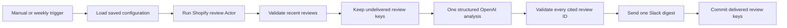

# Shopify App Review Intelligence

Runs `fetch_cat/shopify-app-reviews-scraper` for up to three Shopify App Store
listings, checks a durable delivery ledger, analyzes new review evidence in one
strict OpenAI batch, and sends one source-linked Slack digest.

The workflow has a manual trigger and an inactive weekly schedule for Monday at
09:00 in the workflow timezone. It performs monitoring only and never replies
to merchants or contacts reviewers.

## Setup

1. Install `@apify/n8n-nodes-apify@0.6.10` and import `workflow.json`.
2. Connect Apify, OpenAI, and Slack credentials.
3. Select the destination channel in `Send Slack Review Digest`.
4. Open `Shopify Review Setup Form` and enter one to three Shopify app URLs or
   handles, product context, ratings, lookback days, and the per-app review
   limit.
5. Submit the form once. It creates the shared delivery ledger and the
   `FetchCat Shopify Review Config` table automatically.
6. Run the manual trigger and review the output before activating the weekly
   schedule.

Normal runs exit before Apify when no saved configuration exists.

## Behavior

- Inputs accept up to three `apps.shopify.com` URLs or app handles.
- Rating filters default to one, two, and three stars.
- Lookback is capped at 90 days and Actor retrieval at 25 reviews per app.
- No more than the 30 newest undelivered reviews reach OpenAI.
- The model can report recurring complaints, explicit feature requests,
  positive differentiation, urgent issues, and evidence-backed actions.
- Every insight and action must cite at least one review ID from the current
  batch. Unknown IDs, malformed groups, and unsupported actionable results stop
  the execution before Slack.
- Empty, duplicate, unconfigured, and non-actionable runs make no destination
  write.
- Review keys are written to `FetchCat Delivery Ledger` only after Slack
  succeeds, so failed deliveries remain retryable.

## QA limits

Use at most two Apify-backed executions, ten reviews per QA run, one OpenAI
request on the happy path, one Slack write, and USD 3.33 total QA spend.
Verify the happy, immediate duplicate, empty, malformed-output, and
missing-credential paths. Export, sanitize, reimport, and confirm that the
round-trip copy remains inactive.

Fixtures contain synthetic stores and reviews only.
