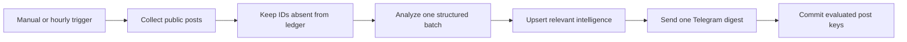

# Monitor Telegram Channels for Market Intelligence

Monitor public Telegram channels with the [Telegram Channel Posts Scraper](https://apify.com/fetch_cat/telegram-channel-posts-scraper) (`fetch_cat/telegram-channel-posts-scraper`), classify unseen posts in one structured OpenAI batch, save relevant intelligence to Google Sheets, and send one concise Telegram digest.

The workflow is designed for competitor monitoring, product announcements, market and crypto news, partnership signals, regulatory updates, risks, and fast-moving industry research. Users define the intelligence goal in plain language, so the same template can serve different niches without editing code.

## Setup

1. Import `workflow.json` into n8n.
2. Open `1. Configure Channel Intelligence` and set public channel handles, the intelligence goal, minimum score, post limits, and digest limit.
3. Create an HTTP Header Auth credential with header `Authorization` and value `Bearer YOUR_APIFY_TOKEN`. Select it in both Apify HTTP Request nodes.
4. Connect OpenAI in `3. Analyze Telegram Posts in One Batch`. The workflow pins `gpt-5.4-mini` and sends one request per non-empty batch, not one request per post.
5. Copy the provided spreadsheet template. Connect Google Sheets and select its `Telegram Intelligence` tab.
6. Create a Telegram bot with `@BotFather`: send `/newbot`, follow the prompts, paste the bot token into a new n8n Telegram credential, add the bot to the destination group or start a private chat, and send one message. Obtain the chat ID from a temporary Telegram Trigger or Telegram's `getUpdates`, then enter it in `5. Send Intelligence Digest to Telegram`.
7. Run manually twice. The first run should save relevant posts and send one digest; the duplicate rerun should send nothing.
8. Publish only when you are ready to enable the hourly schedule.

## Behavior

- The first run treats current posts as unseen and evaluates them immediately.
- OpenAI must return exactly one strict-schema result for every input post; malformed or mismatched output fails closed.
- Relevant posts are sorted by score. Telegram receives at most the configured digest limit, while all qualified posts are saved to Sheets.
- Every evaluated post key is committed only after required delivery succeeds. A Sheets or Telegram failure leaves the batch retryable.
- Empty and fully delivered reruns produce no message and no duplicate spreadsheet rows.
- The workflow never joins channels, replies to authors, or publishes content.

## Cost Guidance

At the time this template was prepared, the Actor charged USD 0.005 per run plus USD 0.000042251 per saved post on Apify's Free pricing tier. Twenty posts once daily are approximately USD 0.18 per month; 20 posts hourly are approximately USD 4.21 per month. OpenAI usage is additional, but batching all posts into one `gpt-5.4-mini` request reduces request overhead and latency compared with one call per post.

n8n Cloud counts every scheduled run as an execution even when no alert is sent. Hourly uses about 720 executions in a 30-day month. Change the Schedule Trigger to daily when immediacy is not important.

## Limitations

- The model evaluates only content and public metrics returned in the current batch; it does not verify claims against external sources.
- Public Telegram counters and available fields vary by channel and post.
- A low item limit or infrequent schedule can miss posts that fall outside the returned newest results.
- The delivery ledger stores post keys in the n8n instance. Moving the workflow to another instance starts a fresh baseline unless the ledger is migrated.

## QA

Use at most three Apify-backed runs: first delivery, duplicate rerun, and one negative or empty path. Verify strict AI output, destination isolation, no duplicate row keys, no second Telegram digest, and no ledger commit after a simulated destination failure.

