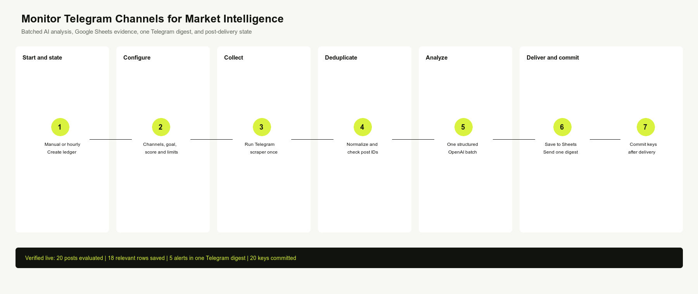
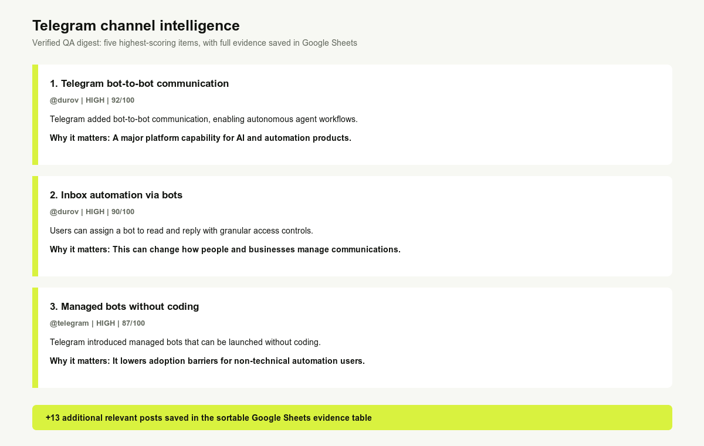

Monitor public Telegram channels for competitor moves, market news, product launches, partnerships, risks, and other business signals. This n8n workflow uses an Apify Telegram scraper, one batched OpenAI analysis, Google Sheets, and Telegram alerts.

Unlike a raw Telegram export, it lets users describe an intelligence goal in plain language, scores every unseen post against that goal, saves relevant evidence, and sends a compact digest only when something matters.

## How it works

1. Runs manually or hourly and prepares a durable delivery ledger.
2. Collects a bounded set of public posts with `fetch_cat/telegram-channel-posts-scraper`.
3. Removes previously evaluated post IDs.
4. Classifies all unseen posts in one strict `gpt-5.4-mini` batch.
5. Saves qualified intelligence to Google Sheets and sends one Telegram digest.
6. Commits post keys only after required delivery succeeds.

## Requirements

- Apify account and API token
- OpenAI API credential
- Google account connected to n8n
- Telegram bot and destination chat ID
- A copy of the supplied Google Sheets template
- Public Telegram channel handles and a written intelligence goal

## Customization

Edit one numbered Set node to change channels, the business intelligence goal, minimum relevance score, maximum posts per channel, total batch size, and maximum alerts per digest. Change the Schedule Trigger from hourly to daily when lower cost matters more than speed.

## Additional information

The workflow works on n8n Cloud and self-hosted n8n with built-in integration nodes. It monitors public content only and never joins channels or contacts authors. At current Free-tier Actor pricing, 20 posts hourly are approximately USD 4.21 per month, plus OpenAI and n8n costs. Once daily is approximately USD 0.18 plus AI usage. Prices are estimates and can change.

