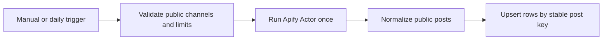

# Export Telegram Channel Posts to Google Sheets with Apify

Collect public Telegram channel posts with the [Telegram Channel Posts Scraper](https://apify.com/fetch_cat/telegram-channel-posts-scraper) (`fetch_cat/telegram-channel-posts-scraper`) and keep a clean, searchable archive in Google Sheets. The workflow runs manually or every day at 09:00, uses only built-in n8n nodes, and works on n8n Cloud or self-hosted n8n.

Each post becomes one row with the channel, public subscriber count, post date and time, direct post link, text, views, reactions, replies, comment count, media count, and extracted links. A stable `Post key` prevents duplicate rows when the same post appears in later runs.

## Setup

1. Import `workflow.json` into n8n.
2. Open `1. Enter Telegram Channels` and enter public handles on separate lines, without `@` or `t.me` URLs.
3. Set `Maximum Posts Per Channel` from 1 to 100 and `Maximum Posts Per Run` from 1 to 500. The defaults are 10 and 20.
4. Create an n8n HTTP Header Auth credential with header `Authorization` and value `Bearer YOUR_APIFY_TOKEN`. Select it in both Apify HTTP Request nodes.
5. Make a copy of the provided Google Sheets template. Connect a Google Sheets OAuth credential and select the copied spreadsheet and its `Telegram Posts` tab in `3. Save Posts to Google Sheets`.
6. Run manually. Check that dates are real spreadsheet date-time values, links open the source posts, and a second run updates existing rows instead of duplicating them.
7. Publish the workflow only when you want the daily schedule to start.

## Behavior

- The example follows `durov` and `telegram`; replace these before activation.
- The workflow calls the Actor once for all configured channels.
- Dates are written as Google Sheets serial values so users can sort, filter, and format them correctly.
- Reruns update rows by `channelHandle:postId`; they do not append duplicates.
- The workflow reads only public channel content. It does not join channels, authenticate to Telegram, contact authors, or send messages.
- If no public posts are returned, the workflow fails with a clear setup error instead of writing misleading empty rows.

## Cost Guidance

At the time this template was prepared, the Actor charged USD 0.005 per run plus USD 0.000042251 per saved post on Apify's Free pricing tier. A daily run returning 20 posts is approximately USD 0.18 per 30-day month. An hourly run at the same limit is approximately USD 4.21 per month. These estimates exclude n8n subscription costs and can change; check the Actor page before activation.

n8n Cloud counts each scheduled workflow run as an execution. Daily uses about 30 executions per month; hourly uses about 720.

## Limitations

- Telegram public counters can change after collection, so reruns refresh the same row.
- A result limit below the number of new posts between runs can miss older posts outside the returned window.
- Private channels, restricted posts, deleted posts, and content unavailable to public web visitors cannot be collected.
- Telegram may not expose all subscriber, reaction, reply, comment, or media fields for every post.

## QA

Use at most three Apify-backed executions: a first run, a duplicate rerun, and one invalid-channel or empty-result test. Confirm that the second run creates no duplicate keys and all writes stay inside the selected QA spreadsheet.

