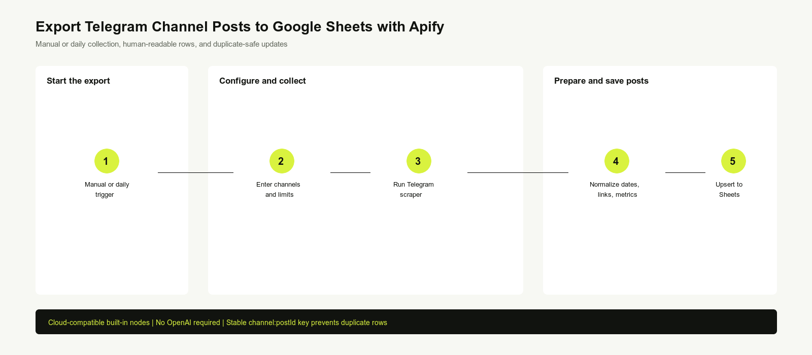
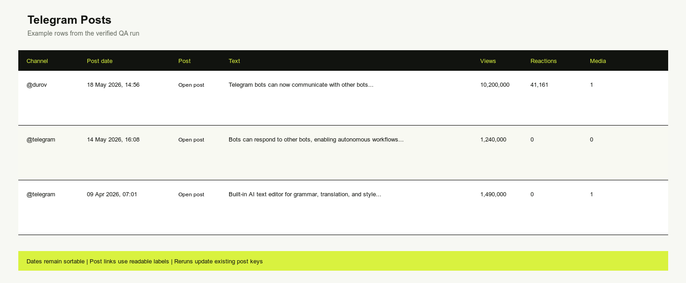

Export public Telegram channel posts to Google Sheets with an Apify scraper and keep a sortable research archive without manual copying. This n8n workflow collects channel posts, text, public engagement metrics, media counts, links, and real spreadsheet date-time values.

It is useful for Telegram channel monitoring, competitor research, news archiving, crypto and Web3 research, market intelligence, content research, and public community analysis. No AI model is required.

## How it works

1. Runs manually or every day at 09:00.
2. Validates one or more public Telegram channel handles and configurable post limits.
3. Runs `fetch_cat/telegram-channel-posts-scraper` once for the complete batch.
4. Normalizes posts into human-readable Google Sheets rows.
5. Updates rows by a stable channel-and-post key, preventing duplicate exports.

## Requirements

- An Apify account and API token
- An n8n HTTP Header Auth credential using `Authorization: Bearer YOUR_APIFY_TOKEN`
- A Google account connected to n8n
- A copy of the supplied spreadsheet template with a `Telegram Posts` tab
- Public Telegram channel handles

## Customization

Change the channel list, maximum posts per channel, total post limit, and schedule in the clearly numbered setup nodes. The default is two example channels, 10 posts per channel, at most 20 posts per run, and one run daily.

## Additional information

The workflow works on n8n Cloud and self-hosted n8n using built-in nodes. It reads public Telegram content only and never joins channels, sends messages, or accesses private data. At current Free-tier Actor pricing, 20 posts once daily are approximately USD 0.18 per month; hourly is approximately USD 4.21 per month. Check current Apify pricing before activation.

