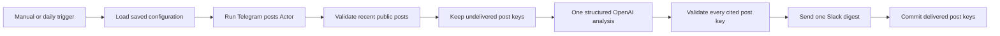

# Telegram Competitor Intelligence Digest

Runs `fetch_cat/telegram-channel-posts-scraper` for up to ten public Telegram
channels, checks a durable delivery ledger, analyzes new post evidence in one
strict OpenAI batch, and sends one source-linked Slack digest.

The workflow has a manual trigger and an inactive daily schedule for 08:00 in
the workflow timezone. It monitors only and never posts, comments, or contacts
channel owners or subscribers.

## Setup

1. Install `@apify/n8n-nodes-apify@0.6.10` and import `workflow.json`.
2. Connect Apify, OpenAI, and Slack credentials.
3. Select the destination channel in `Send Slack Intelligence Digest`.
4. Open `Telegram Intelligence Setup Form` and enter one to ten public channel
   handles or URLs, competitor and market context, lookback hours, and the
   per-channel post limit.
5. Submit the form once. It creates the shared delivery ledger and
   `FetchCat Telegram Intelligence Config` table automatically.
6. Run the manual trigger and review the output before activating the daily
   schedule.

Normal runs exit before Apify when no saved configuration exists.

## Behavior

- Inputs accept up to ten public channel handles, `t.me` URLs, or
  `telegram.me` URLs.
- Lookback is capped at seven days and retrieval at 25 posts per channel.
- The overall Actor and AI batch is capped at 50 posts.
- Media URLs and comment bodies are disabled. Public comment counts remain
  enabled as an engagement signal.
- The model can report launches, promotions, positioning changes, topic shifts,
  unusually strong posts, and evidence-backed actions.
- Every insight and action must cite a supplied `channelHandle:postId` key.
  Unknown keys, malformed groups, and unsupported material results stop the
  execution before Slack.
- Empty, duplicate, unconfigured, and non-material runs make no destination
  write.
- Post keys are written to `FetchCat Delivery Ledger` only after Slack
  succeeds, so failed deliveries remain retryable.

## QA limits

Use at most two Apify-backed executions, ten posts per QA run, one OpenAI
request on the happy path, one Slack write, and USD 3.33 total QA spend.
Verify the happy, immediate duplicate, empty, malformed-output, and
missing-credential paths. Export, sanitize, reimport, and confirm that the
round-trip copy remains inactive.

Fixtures contain synthetic channels and posts only.
