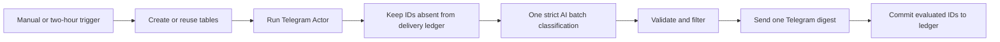

# Telegram Competitor Intelligence Digest

Monitor public Telegram channels with `fetch_cat/telegram-channel-posts-scraper`, deduplicate delivered posts in an n8n Data Table, ask OpenAI for one evidence-bound analysis, and send one Slack digest. The workflow is inactive by default and is designed for daily execution after QA.

## What it does

- Runs the FetchCat Telegram Actor with a capped channel list and `maxItems` limit.
- Normalizes post IDs, channel names, URLs, timestamps, views, reactions, replies, links, hashtags, and text snippets.
- Checks the durable `FetchCat Delivery Ledger` before AI or Slack so repeated posts do not create duplicate digests.
- Uses one `gpt-5.4-mini` batch prompt to identify launches, promotions, positioning changes, topics, and unusually strong posts.
- Sends a single Slack digest only when qualified new signals exist, then commits ledger rows only after delivery succeeds.

## Setup

Create credentials for Apify, OpenAI, and Slack in n8n. Use the setup form to save public Telegram channels, product context, minimum engagement, destination Slack channel, and run caps. Keep QA runs at or below 10 Actor items and one AI call. Private or deleted channels may return no usable posts; that empty path intentionally sends nothing and commits nothing.

## Safety and limits

The graph enforces the QA envelope: at most 10 Actor items, two Apify-backed QA executions, one AI request on the happy path, and one Slack write. AI output is parsed as JSON and must cite post URLs. Malformed or uncited analysis stops before Slack. Ledger writes happen after Slack delivery, keeping failed delivery retryable.

# Telegram Competitor Intelligence Digest

Runs `fetch_cat/telegram-channel-posts-scraper` for a configurable search and optional
subtelegram, checks a durable delivery ledger, classifies all new posts in one
strict structured AI call, and sends one Telegram digest containing
at most five qualified posts.

The workflow has a manual trigger and a two-hour schedule. It monitors only: it
never comments, replies, messages authors, or performs outreach.

## Setup

1. Install `@apify/n8n-nodes-apify@0.6.10` and import `workflow.json`.
2. Add Apify and OpenAI credentials to the processing nodes.
3. Create a Telegram group, add a dedicated bot, and
   connect the bot credential in n8n.
4. Select that group's chat ID in `Send Telegram Digest`.
5. Run `Telegram Setup Form` once and save the search and product context. The
   workflow creates both required Data Tables automatically. If the form is
   skipped, the first normal run creates safe defaults.
6. Optionally import `../shared-error-notifications/workflow.json` and select it as this
   workflow's error workflow. Keep the schedule unpublished until QA passes.

The generated `FetchCat Telegram Config` row can also be edited directly in n8n
Data Tables. Start with global relevance search unless a specific subtelegram is
known to return useful results.

## Behavior

- Actor search sort and time window are configurable; defaults are global
  relevance over the past week, with comments disabled.
- No more than 10 posts reach one OpenAI batch request.
- Batch validation fails closed unless every input Telegram ID has exactly one
  result and there are no extras.
- Only `high` or `medium` buying intent above the threshold can pass.
- IDs are committed only after Telegram succeeds, so destination failures stay
  retryable.
- Alerts include subtelegram, post age, Telegram score, comment count, summary,
  qualification reason, and a direct post link.
- Duplicate, empty, and below-threshold runs send no Telegram message.

## QA

Use no more than three Apify-backed runs: a happy path, an immediate duplicate
rerun, and a negative/empty query. Confirm the happy path sends at most one
message with five posts, and the duplicate and negative paths send nothing.
Then export, sanitize, reimport, and execute the sanitized workflow.

The fixtures are synthetic and do not represent real Telegram users or posts.
