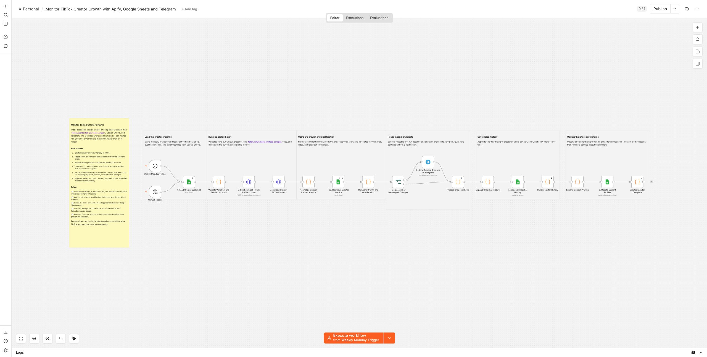
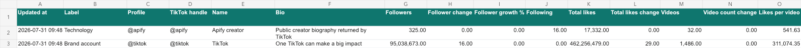

Monitor TikTok creator growth, influencer shortlists, and competitor profiles
with `fetch_cat/tiktok-profile-scraper`, Google Sheets, and Telegram. The
workflow keeps dated history, calculates follower and content-output changes,
and alerts only when a profile establishes its baseline or crosses a meaningful
threshold.

## Who is it for?

- Influencer marketers maintaining creator shortlists
- Social media teams tracking competitors and partner accounts
- Agencies that need reusable TikTok profile monitoring and weekly reports
- Researchers who want historical creator growth data without manual copying

## How it works

1. Reads active handles and thresholds from an editable `Creators` sheet.
2. Runs one efficient FetchCat profile-scraping batch every Monday or manually.
3. Compares followers, total likes, videos, and qualification with the previous
   successful snapshot.
4. Sends a labelled Telegram baseline on the first run and later alerts only
   for material growth, decline, or qualification changes.
5. Appends `Snapshot History` and updates one latest row per handle in
   `Current Profiles`.

## Setup

Create the three documented Sheet tabs, add handles and thresholds, and connect
Google Sheets in each Sheet node. Create an HTTP Header Auth credential with
`Authorization: Bearer YOUR_APIFY_TOKEN` for the two FetchCat request nodes.
Create a Telegram bot with `@BotFather`, add it to the destination chat, send a
message, and configure its bot credential and chat ID in the Telegram node.

The workflow runs on n8n Cloud or self-hosted n8n and does not require OpenAI.
At current Free-tier Actor pricing, 50 profiles cost approximately USD 0.0102
per run or USD 0.044 per average month on the weekly default.

