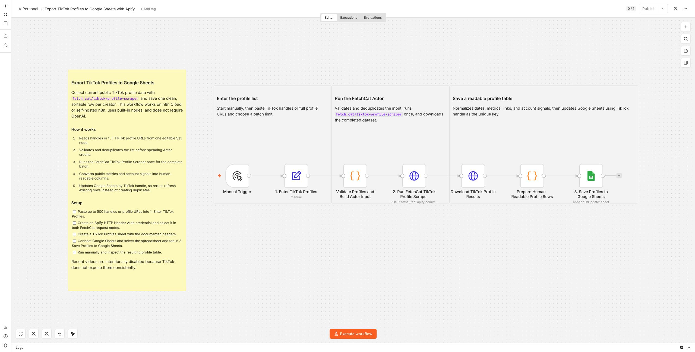
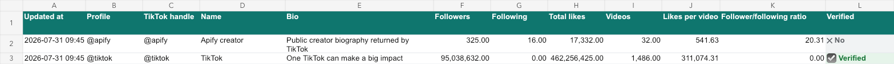

Export public TikTok profile data to Google Sheets with
`fetch_cat/tiktok-profile-scraper`. Paste TikTok usernames or profile URLs,
run one efficient Apify batch manually or every day at 09:00, and maintain one
clean, current row per creator.

The workflow is useful for influencer research, creator-list enrichment,
competitor research, campaign planning, and TikTok profile data collection. It
captures follower and following counts, total likes, videos, bio, verification,
region, language, bio link, commerce signals, live status, and calculated
profile ratios when TikTok exposes them.

## How it works

1. Starts manually or every day at 09:00 and accepts comma- or newline-separated TikTok handles and profile URLs.
2. Validates and deduplicates up to 500 creators.
3. Runs the FetchCat TikTok Profile Scraper once for the complete list.
4. Normalizes public profile data into readable spreadsheet columns.
5. Updates Google Sheets by TikTok handle so reruns refresh existing rows.

## Setup

Open the [public spreadsheet template](https://docs.google.com/spreadsheets/d/11sXzrv9g7rECryFt6HkWcXQxh7hpyHteuRT-cxcQZrE/edit?usp=drive_link),
choose **File > Make a copy**, and save your private copy in Google Drive. Its
`TikTok Profiles` tab already contains the required columns and formatting.

Create an n8n HTTP Header Auth credential with header `Authorization` and value
`Bearer YOUR_APIFY_TOKEN`, then select it in both FetchCat request nodes.
Connect Google Sheets, select your copied spreadsheet and its `TikTok Profiles`
tab, and replace the example handles in `1. Enter TikTok Profiles`. Test
manually, then publish the workflow to enable the daily schedule.

The workflow runs on n8n Cloud or self-hosted n8n, uses built-in nodes, and does
not require an AI model. At current Free-tier Actor pricing, 25 profiles cost
approximately USD 0.0076 and 500 profiles approximately USD 0.057 per run.

